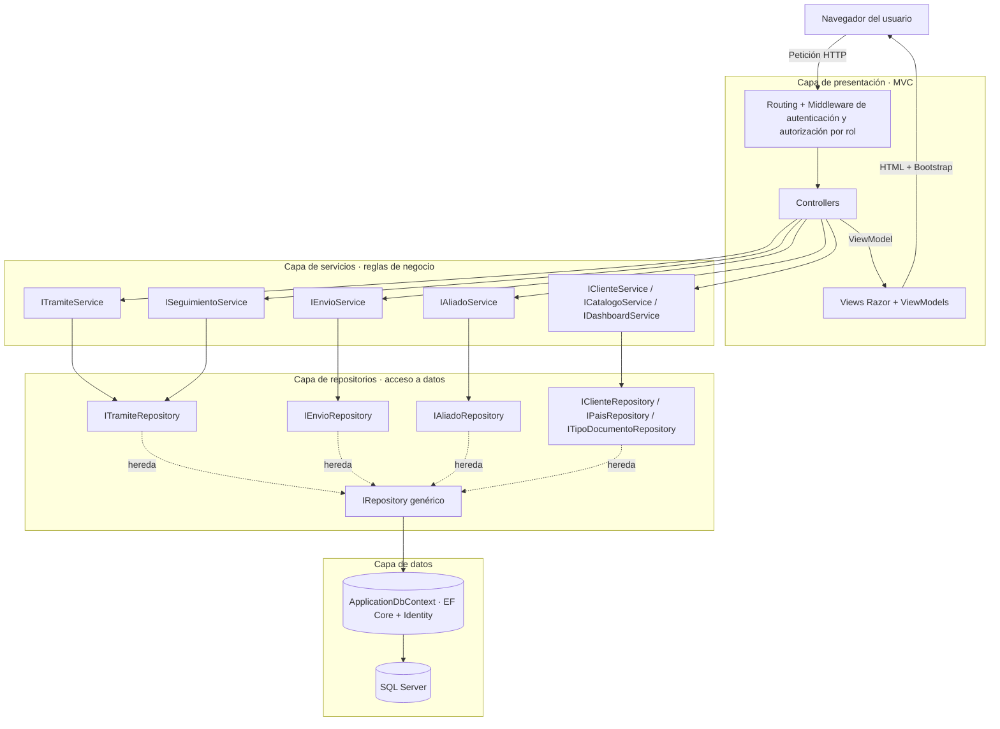
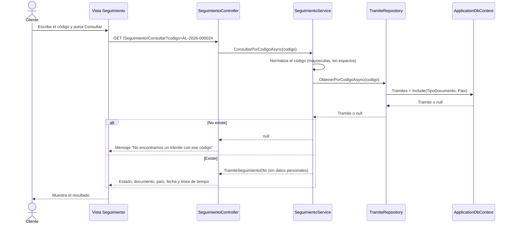
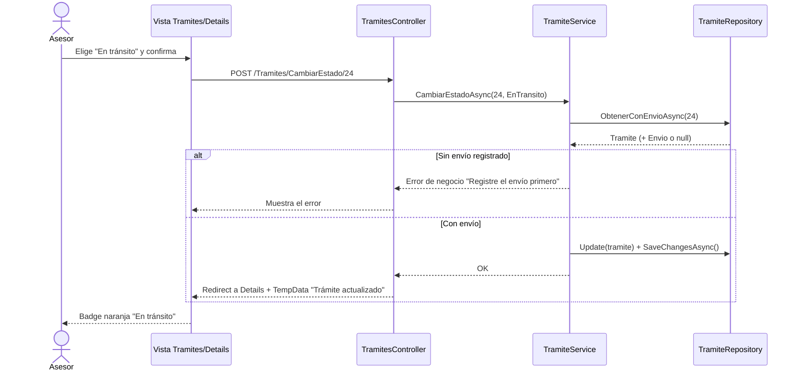
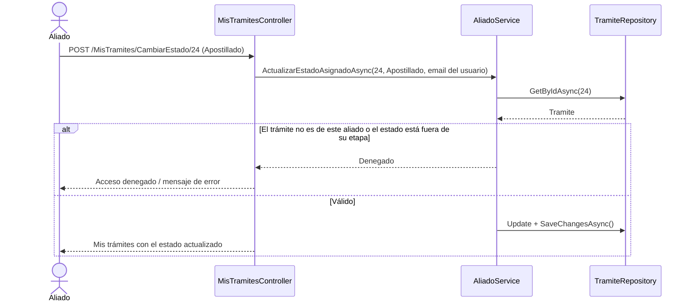
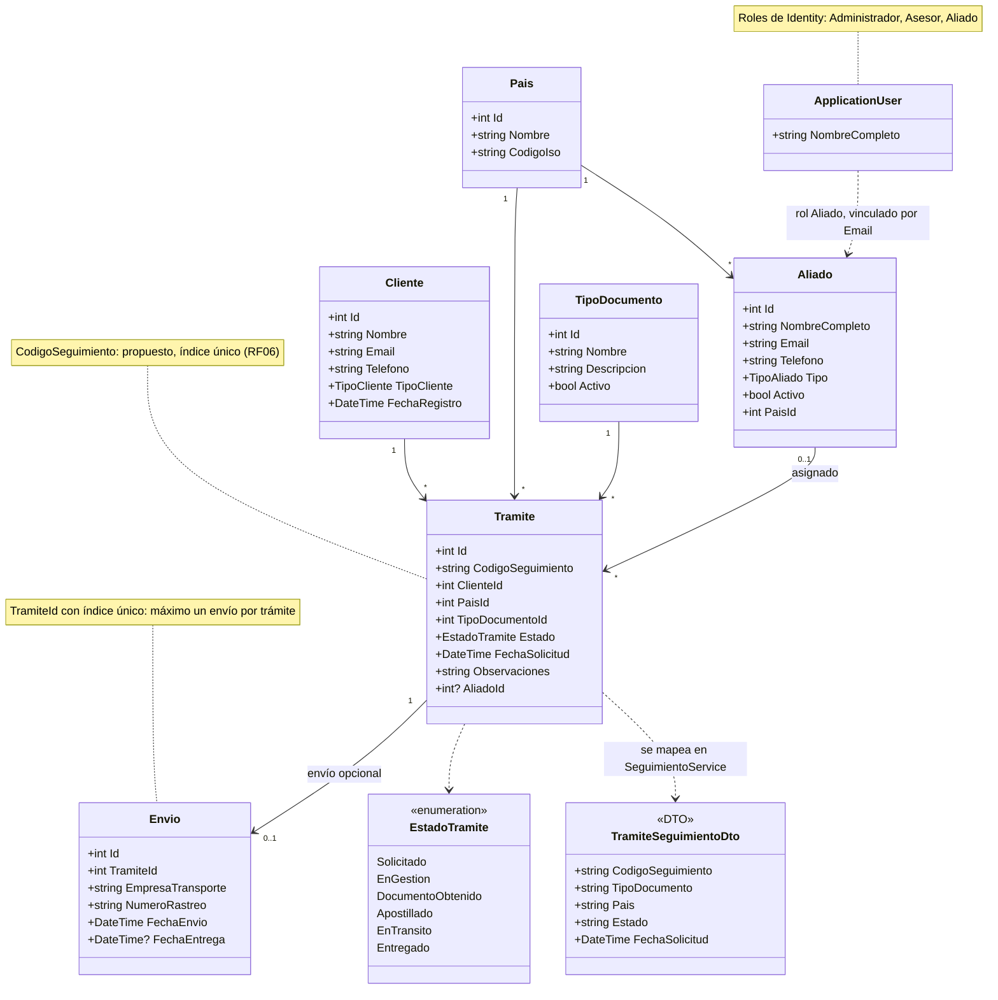

# Diagrama MVC y arquitectura en capas

**Proyecto:** Aliada Legal
**Responsable:** Blanca Rivas (Integrante 1 — UX y documentación)

Arquitectura acordada en la Fase 1: **Presentación MVC → Servicios → Repositorios → Base de datos**.

---

## 1. Arquitectura general por capas

Regla principal: cada capa solo llama a la capa inmediatamente inferior. Los controladores nunca usan `ApplicationDbContext`.

## 2. Secuencia: consulta pública de seguimiento (RF06)

## 3. Secuencia: el Asesor cambia el estado de un trámite

## 4. Secuencia: el Aliado actualiza un trámite asignado (RF05)

## 5. Diagrama de clases del modelo

> **Decisión de diseño de esta versión:** un trámite tiene **cero o un envío** (1 a 0..1). Se garantiza con un índice único sobre `Envio.TramiteId` y con la validación de `EnvioService`. Si más adelante se necesitan reenvíos, la relación puede pasar a 1 a N.

## 6. Resumen de responsabilidades

| Capa | Hace | No debe |
|---|---|---|
| **Vista** | Mostrar datos y capturar entradas; menú según rol | Consultar la base de datos |
| **Controlador** | Validar `ModelState`, aplicar `[Authorize(Roles)]`, llamar al servicio y elegir la vista | Usar `ApplicationDbContext` o tener reglas de negocio |
| **Servicio** | Reglas de negocio (estados, un envío por trámite, código de seguimiento, permisos del Aliado) y mapeo a DTO | Conocer vistas o HTML |
| **Repositorio** | Consultas y guardado con EF Core | Tomar decisiones de negocio |
| **Modelo** | Definir datos, validaciones y relaciones | Saber qué vista lo muestra |
