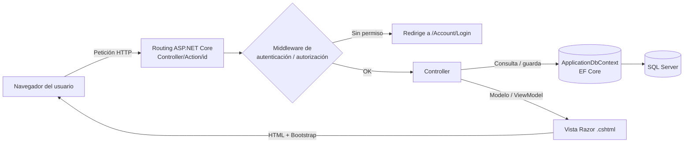
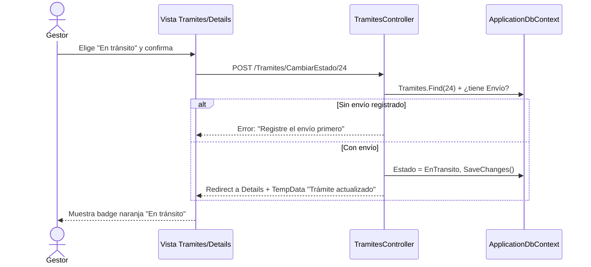
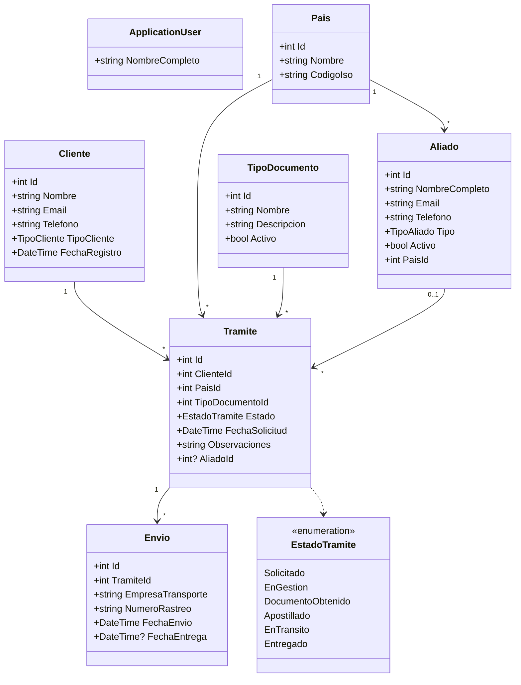
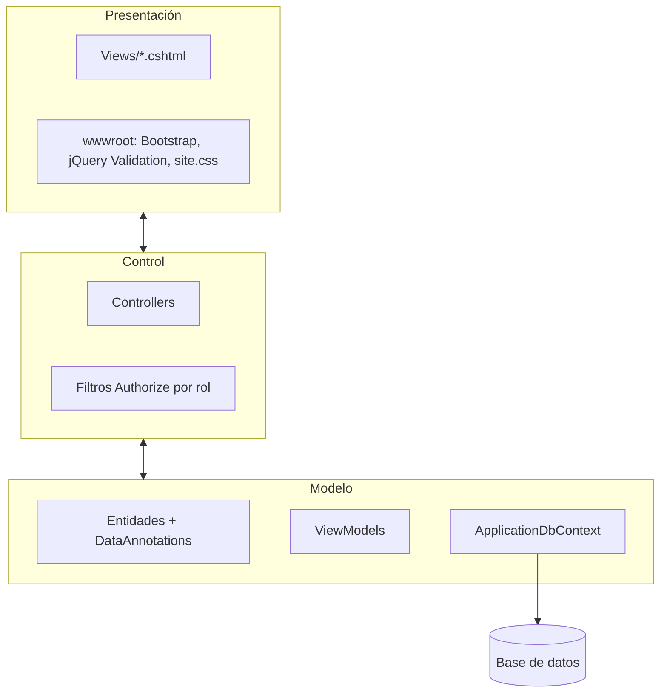

# Diagrama MVC

**Proyecto:** Aliada Legal
**Responsable:** Blanca Rivas (Integrante 1 — UX y documentación)

---

## 1. Arquitectura general

## 2. Secuencia: cambiar el estado de un trámite

## 3. Diagrama de clases del Modelo

## 4. Capas y responsabilidades

| Capa | Responsabilidad | No debe |
|---|---|---|
| **Vista** | Mostrar datos y capturar entradas | Consultar la base de datos |
| **Controlador** | Validar `ModelState`, aplicar reglas de flujo (ej. no pasar a En tránsito sin envío), elegir la vista | Tener HTML ni lógica de presentación |
| **Modelo** | Definir datos, validaciones y relaciones | Saber qué vista lo muestra |
