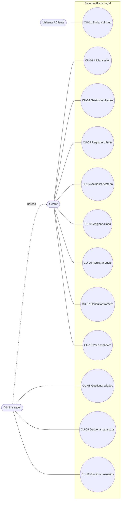

# Casos de uso

**Proyecto:** Aliada Legal
**Responsable:** Blanca Rivas (Integrante 1 — UX y documentación)

---

## 1. Actores

| Actor | Descripción |
|---|---|
| **Visitante / Cliente** | Persona o bufete que consulta los servicios y envía una solicitud desde el sitio público. |
| **Gestor** | Usuario interno que opera los trámites día a día. |
| **Administrador** | Usuario interno con control total. Hereda todos los casos de uso del Gestor. |

## 2. Diagrama general

> Relaciones: CU-04 **incluye** CU-07 (se busca el trámite antes de actualizarlo). CU-06 **extiende** CU-04 (al registrar el envío, el estado puede pasar a En tránsito).

## 3. Especificación de casos de uso principales

### CU-01 Iniciar sesión
| Campo | Detalle |
|---|---|
| Actor | Gestor, Administrador |
| Precondición | El usuario tiene una cuenta registrada. |
| Flujo principal | 1. El usuario abre **/Account/Login**. 2. Escribe correo y contraseña. 3. El sistema valida las credenciales. 4. Redirige al Dashboard. |
| Flujo alterno | 3a. Credenciales incorrectas: muestra un error y conserva el correo escrito. |
| Postcondición | Sesión iniciada con el rol correspondiente. |

### CU-02 Gestionar clientes
| Campo | Detalle |
|---|---|
| Actor | Gestor, Administrador |
| Precondición | Sesión iniciada. |
| Flujo principal | 1. Entra a **Clientes**. 2. Pulsa **Nuevo cliente**. 3. Llena nombre, correo, teléfono y tipo. 4. Guarda. 5. El sistema valida y muestra un mensaje de éxito. |
| Flujo alterno | 4a. Hay datos inválidos: se muestran errores junto a cada campo. 1a. Editar o ver detalle desde la lista. |
| Postcondición | Cliente guardado con su fecha de registro. |

### CU-03 Registrar trámite
| Campo | Detalle |
|---|---|
| Actor | Gestor, Administrador |
| Precondición | Existen el cliente, el país y el tipo de documento. |
| Flujo principal | 1. Entra a **Trámites → Nuevo**. 2. Selecciona cliente, país y tipo de documento. 3. Escribe observaciones (opcional). 4. Guarda. 5. El sistema crea el trámite en estado **Solicitado**. |
| Flujo alterno | 2a. El cliente no existe: enlace a **Nuevo cliente** y luego regresa. |
| Postcondición | Trámite creado y visible en la lista. |

### CU-04 Actualizar estado del trámite
| Campo | Detalle |
|---|---|
| Actor | Gestor, Administrador |
| Precondición | El trámite existe y no está Entregado. |
| Flujo principal | 1. Busca el trámite (CU-07). 2. Abre el detalle. 3. Elige el nuevo estado. 4. Confirma. 5. El sistema guarda y actualiza la etiqueta. |
| Flujo alterno | 3a. Intenta pasar a En tránsito sin envío: el sistema pide registrar el envío primero (CU-06). |
| Postcondición | Estado actualizado. |

### CU-05 Asignar aliado
| Campo | Detalle |
|---|---|
| Actor | Gestor, Administrador |
| Precondición | Hay al menos un aliado activo. |
| Flujo principal | 1. En el detalle del trámite pulsa **Asignar aliado**. 2. Elige un aliado activo de la lista. 3. Guarda. |
| Postcondición | Trámite con `AliadoId` asignado. Se sugiere cambiar el estado a En gestión. |

### CU-06 Registrar envío
| Campo | Detalle |
|---|---|
| Actor | Gestor, Administrador |
| Precondición | El trámite está Documento obtenido o Apostillado. |
| Flujo principal | 1. En el detalle pulsa **Registrar envío**. 2. Escribe la empresa de transporte y el número de rastreo. 3. Guarda. 4. El trámite pasa a **En tránsito**. |
| Flujo alterno | Más adelante se edita el envío para poner la fecha de entrega y el trámite pasa a **Entregado**. |
| Postcondición | Envío vinculado al trámite. |

### CU-11 Enviar solicitud (sitio público)
| Campo | Detalle |
|---|---|
| Actor | Visitante / Cliente |
| Precondición | Ninguna. |
| Flujo principal | 1. Abre **Inicio → Solicitar documento**. 2. Escribe sus datos y elige país y documento. 3. Envía. 4. El sistema crea o reutiliza el Cliente y crea el Trámite. 5. Muestra la confirmación. |
| Flujo alterno | 3a. Faltan datos: errores en línea sin perder lo que ya escribió. |
| Postcondición | Trámite en estado Solicitado, visible para el Gestor. |

Los casos CU-07 a CU-10 y CU-12 son operaciones CRUD o de consulta estándar sobre sus entidades, con el mismo patrón: lista → crear/editar → validar → mensaje de confirmación.
