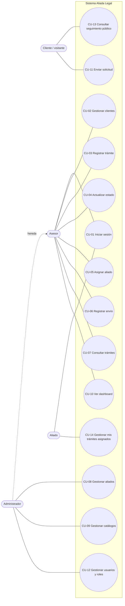

# Casos de uso

**Proyecto:** Aliada Legal
**Responsable:** Blanca Rivas (Integrante 1 — UX y documentación)

---

## 1. Actores

| Actor | Descripción |
|---|---|
| **Cliente / visitante** | Persona o bufete sin cuenta. Consulta el estado de su trámite con el código de seguimiento (RF06) y puede enviar una solicitud desde el sitio público. |
| **Asesor** | Usuario interno que atiende clientes y opera los trámites día a día. |
| **Administrador** | Usuario interno con control total. Hereda todos los casos de uso del Asesor. |
| **Aliado** | Abogado o notario con cuenta restringida. Ve y actualiza solo los trámites que tiene asignados (RF05). |

## 2. Diagrama general

> Relaciones: CU-04 **incluye** CU-07 (se busca el trámite antes de actualizarlo). CU-06 **extiende** CU-04 (al registrar el envío, el estado puede pasar a En tránsito). CU-14 **incluye** CU-04 con restricción de etapa (el aliado solo mueve el trámite entre En gestión, Documento obtenido y Apostillado).

## 3. Especificación de casos de uso principales

### CU-01 Iniciar sesión (RF05)
| Campo | Detalle |
|---|---|
| Actor | Asesor, Administrador, Aliado |
| Precondición | El usuario tiene una cuenta con uno de los roles Administrador, Asesor o Aliado. |
| Flujo principal | 1. El usuario abre **/Account/Login**. 2. Escribe correo y contraseña. 3. El sistema valida las credenciales con Identity. 4. Redirige según el rol: Administrador/Asesor → Dashboard; Aliado → Mis trámites. |
| Flujo alterno | 3a. Credenciales incorrectas: muestra un error y conserva el correo escrito. 4a. El aliado está desactivado: se bloquea el acceso con un mensaje. |
| Postcondición | Sesión iniciada con el rol correspondiente. |

### CU-02 Gestionar clientes
| Campo | Detalle |
|---|---|
| Actor | Asesor, Administrador |
| Precondición | Sesión iniciada con rol Asesor o Administrador. |
| Flujo principal | 1. Entra a **Clientes**. 2. Pulsa **Nuevo cliente**. 3. Llena nombre, correo, teléfono y tipo. 4. Guarda. 5. El sistema valida y muestra un mensaje de éxito. |
| Flujo alterno | 4a. Hay datos inválidos: se muestran errores junto a cada campo. 1a. Editar o ver detalle desde la lista. |
| Postcondición | Cliente guardado con su fecha de registro. |

### CU-03 Registrar trámite
| Campo | Detalle |
|---|---|
| Actor | Asesor, Administrador |
| Precondición | Existen el cliente, el país y el tipo de documento. |
| Flujo principal | 1. Entra a **Trámites → Nuevo**. 2. Selecciona cliente, país y tipo de documento. 3. Escribe observaciones (opcional). 4. Guarda. 5. El sistema crea el trámite en estado **Solicitado** y genera su **código de seguimiento**. 6. El asesor copia el código y se lo entrega al cliente. |
| Flujo alterno | 2a. El cliente no existe: enlace a **Nuevo cliente** y luego regresa. |
| Postcondición | Trámite creado, visible en la lista y consultable en la página pública de seguimiento. |

### CU-04 Actualizar estado del trámite
| Campo | Detalle |
|---|---|
| Actor | Asesor, Administrador (y Aliado mediante CU-14) |
| Precondición | El trámite existe y no está Entregado. |
| Flujo principal | 1. Busca el trámite (CU-07). 2. Abre el detalle. 3. Elige el nuevo estado. 4. Confirma. 5. El sistema guarda y actualiza la etiqueta. |
| Flujo alterno | 3a. Intenta pasar a En tránsito sin envío: el sistema pide registrar el envío primero (CU-06). |
| Postcondición | Estado actualizado y visible en la consulta pública. |

### CU-05 Asignar aliado
| Campo | Detalle |
|---|---|
| Actor | Asesor, Administrador |
| Precondición | Hay al menos un aliado activo. |
| Flujo principal | 1. En el detalle del trámite pulsa **Asignar aliado**. 2. Elige un aliado activo de la lista. 3. Guarda. |
| Postcondición | Trámite con `AliadoId` asignado; aparece en **Mis trámites** del aliado. Se sugiere cambiar el estado a En gestión. |

### CU-06 Registrar envío
| Campo | Detalle |
|---|---|
| Actor | Asesor, Administrador |
| Precondición | El trámite está Documento obtenido o Apostillado y **todavía no tiene envío** (máximo uno por trámite). |
| Flujo principal | 1. En el detalle pulsa **Registrar envío**. 2. Escribe la empresa de transporte y el número de rastreo. 3. Guarda. 4. El trámite pasa a **En tránsito**. |
| Flujo alterno | 1a. El trámite ya tiene envío: el botón es **Editar envío**. Más adelante se edita para poner la fecha de entrega y el trámite pasa a **Entregado**. |
| Postcondición | Un único envío vinculado al trámite. |

### CU-11 Enviar solicitud (sitio público)
| Campo | Detalle |
|---|---|
| Actor | Cliente / visitante |
| Precondición | Ninguna. |
| Flujo principal | 1. Abre **Inicio → Solicitar documento**. 2. Escribe sus datos y elige país y documento. 3. Envía. 4. El sistema crea o reutiliza el Cliente y crea el Trámite. 5. Muestra la confirmación con el código de seguimiento. |
| Flujo alterno | 3a. Faltan datos: errores en línea sin perder lo que ya escribió. |
| Postcondición | Trámite en estado Solicitado, visible para el Asesor. |

### CU-13 Consultar seguimiento público (RF06)
| Campo | Detalle |
|---|---|
| Actor | Cliente / visitante |
| Precondición | El cliente tiene un código de seguimiento entregado por la agencia. No requiere sesión. |
| Flujo principal | 1. Abre **Seguimiento** desde el menú público. 2. Escribe su código. 3. Pulsa **Consultar**. 4. El sistema busca el trámite por código. 5. Muestra tipo de documento, país, estado (con color y línea de tiempo) y fecha de solicitud. |
| Flujo alterno | 4a. El código no existe: muestra un mensaje amable y conserva lo escrito. 2a. Campo vacío: validación en línea "Escribe tu código de seguimiento". |
| Postcondición | El cliente conoce el estado actual. No se exponen datos personales. |

### CU-14 Gestionar mis trámites asignados (RF05)
| Campo | Detalle |
|---|---|
| Actor | Aliado |
| Precondición | Sesión iniciada con rol Aliado; la cuenta está vinculada a un registro `Aliado` activo. |
| Flujo principal | 1. Entra a **Mis trámites** (solo ve trámites con su `AliadoId`). 2. Abre un trámite. 3. Cambia el estado a Documento obtenido o Apostillado. 4. Agrega una observación (opcional). 5. Guarda. |
| Flujo alterno | 2a. Intenta abrir un trámite de otro aliado: **Acceso denegado**. 3a. Intenta un estado fuera de su etapa: la opción no aparece y el servidor la rechaza. |
| Postcondición | Estado actualizado; el Asesor y el cliente ven el avance. |

Los casos CU-07 a CU-10 y CU-12 son operaciones CRUD o de consulta estándar sobre sus entidades, con el mismo patrón: lista → crear/editar → validar → mensaje de confirmación.
