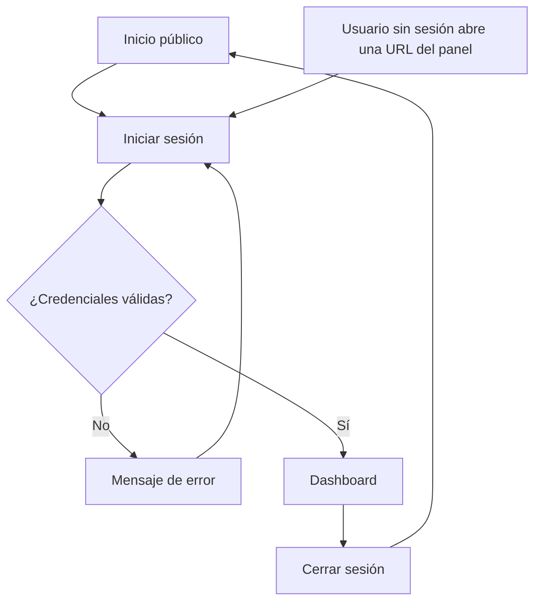
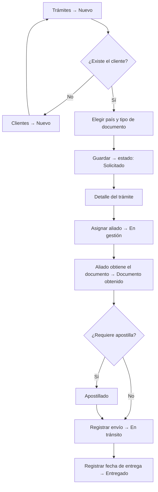
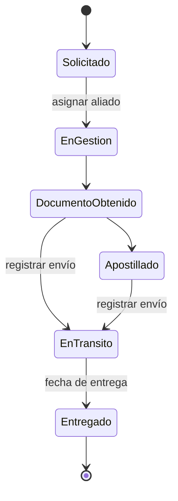
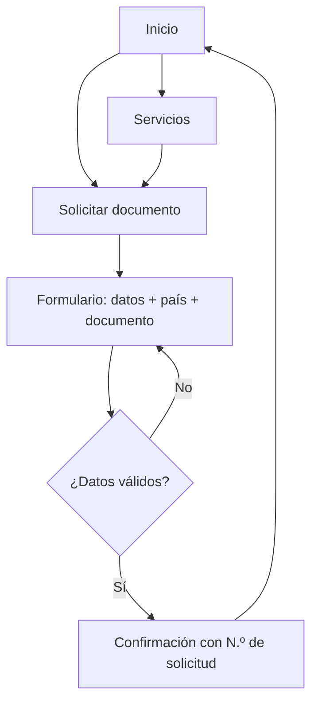
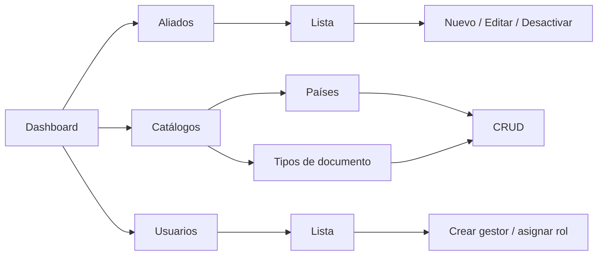

# Flujos de navegación

**Proyecto:** Aliada Legal
**Responsable:** Blanca Rivas (Integrante 1 — UX y documentación)

Los diagramas están en Mermaid y GitHub los muestra automáticamente.

---

## 1. Flujo de autenticación

## 2. Flujo principal: ciclo de vida de un trámite

Este es el flujo más importante del sistema y sigue los estados del enum `EstadoTramite`.

### Diagrama de estados

## 3. Flujo de solicitud pública (cliente)

## 4. Flujo de administración (solo Administrador)

## 5. Reglas de navegación

1. **Máximo 3 clics** desde el Dashboard hasta cualquier acción frecuente (crear trámite, cambiar estado, registrar envío).
2. **Breadcrumbs** en todas las páginas del panel (ej. *Dashboard / Trámites / #24*).
3. Después de crear o editar, se redirige al **detalle** del registro y se muestra un mensaje de éxito (TempData + alerta de Bootstrap).
4. **Botón Cancelar** en todos los formularios para volver a la lista sin guardar.
5. Las acciones destructivas (desactivar aliado) piden **confirmación** en un modal.
