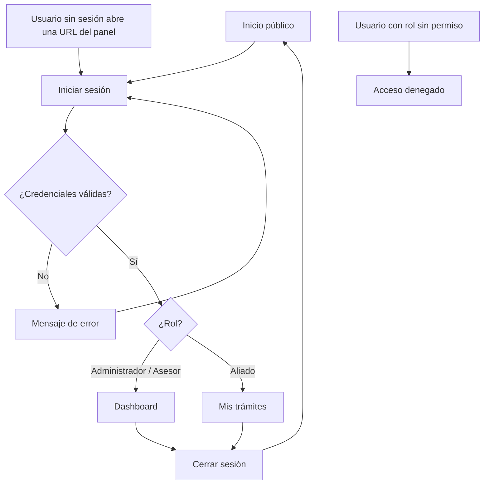
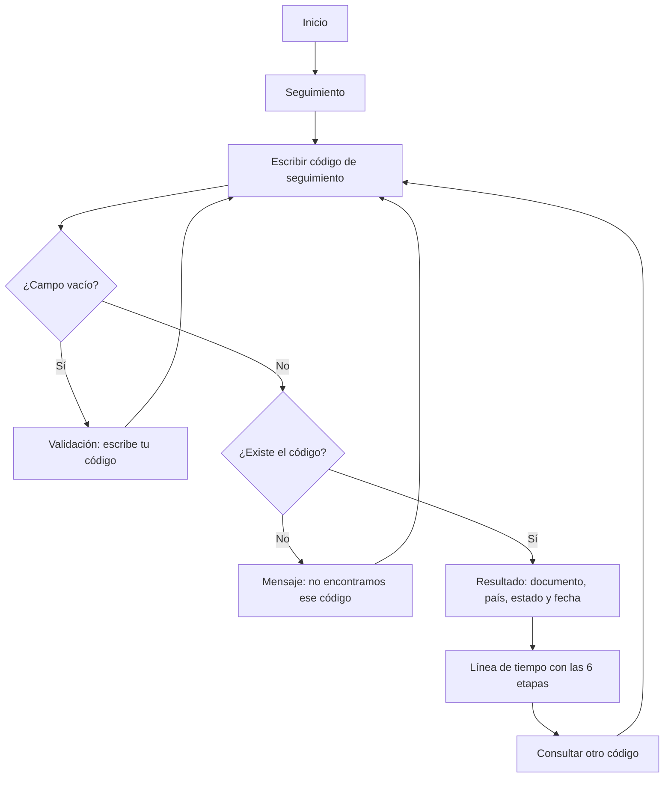
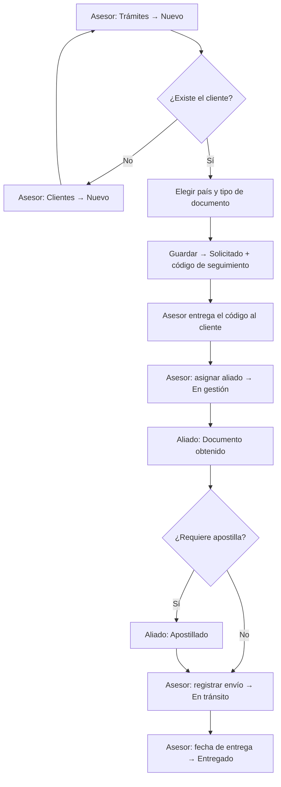
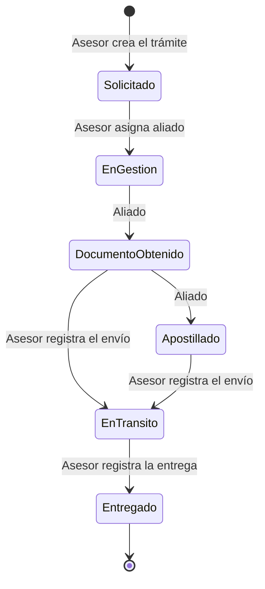
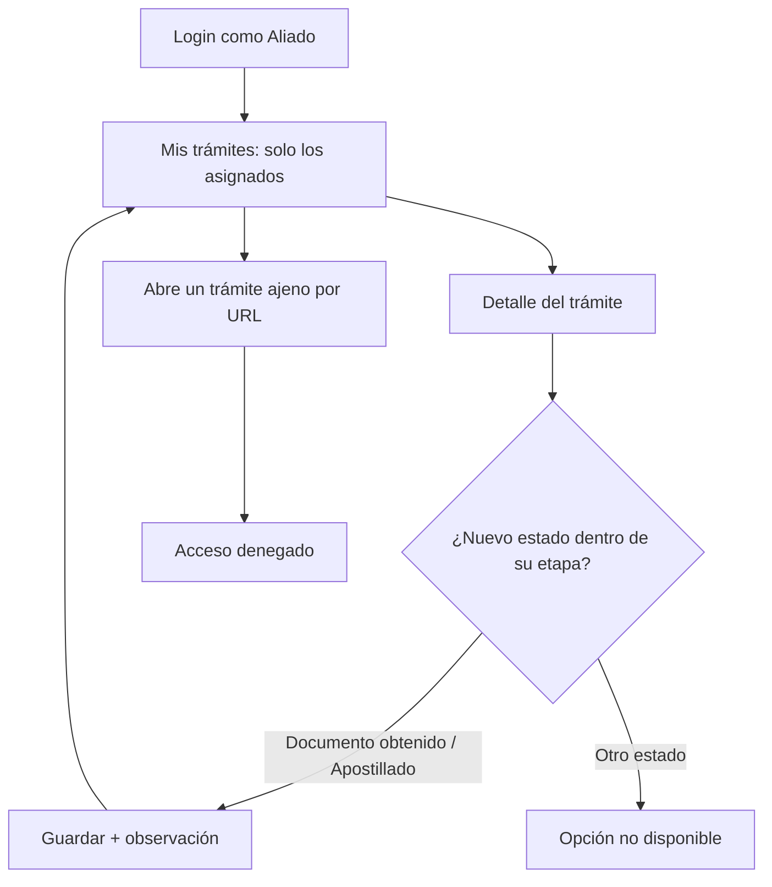
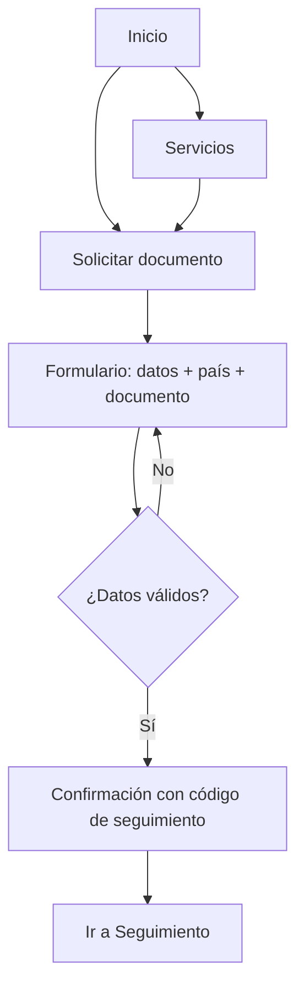
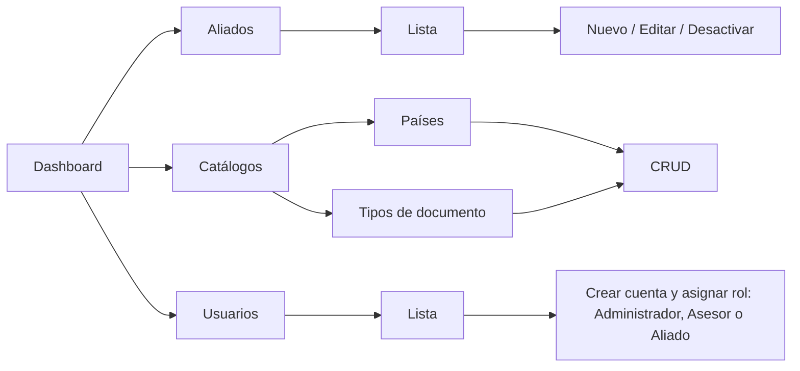

# Flujos de navegación

**Proyecto:** Aliada Legal
**Responsable:** Blanca Rivas (Integrante 1 — UX y documentación)

Los diagramas están en Mermaid y GitHub los muestra automáticamente.

---

## 1. Flujo de autenticación por rol (RF05)

## 2. Flujo de consulta pública de seguimiento (RF06)

## 3. Flujo principal: ciclo de vida de un trámite

Sigue los estados del enum `EstadoTramite` e indica qué rol hace cada paso.

### Diagrama de estados

## 4. Flujo del Aliado (RF05)

## 5. Flujo de solicitud pública (cliente)

## 6. Flujo de administración (solo Administrador)

## 7. Reglas de navegación

1. **Máximo 3 clics** desde el Dashboard hasta cualquier acción frecuente (crear trámite, cambiar estado, registrar envío).
2. La **consulta de seguimiento** está a 1 clic desde cualquier página pública (enlace fijo en el menú).
3. **Breadcrumbs** en todas las páginas del panel (ej. *Dashboard / Trámites / AL-2026-000024*).
4. Después de crear o editar, se redirige al **detalle** del registro y se muestra un mensaje de éxito (TempData + alerta de Bootstrap).
5. **Botón Cancelar** en todos los formularios para volver a la lista sin guardar.
6. Las acciones destructivas (desactivar aliado) piden **confirmación** en un modal.
7. El menú solo muestra las opciones del rol de la sesión; si alguien entra por URL a algo no permitido, ve **Acceso denegado**.
