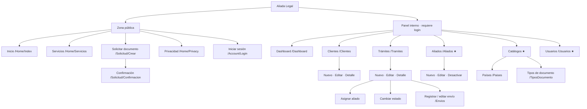

# Mapa del sistema y justificación UX

**Proyecto:** Aliada Legal
**Responsable:** Blanca Rivas (Integrante 1 — UX y documentación)

---

## 1. Mapa del sitio



★ = solo rol Administrador.

## 2. Inventario de pantallas

| # | Pantalla | Ruta (Controller/Action) | Acceso |
|---|---|---|---|
| 1 | Inicio | `Home/Index` | Público |
| 2 | Servicios | `Home/Servicios` | Público |
| 3 | Solicitar documento | `Solicitud/Crear` | Público |
| 4 | Confirmación de solicitud | `Solicitud/Confirmacion` | Público |
| 5 | Iniciar sesión | `Account/Login` | Público |
| 6 | Dashboard | `Dashboard/Index` | Admin, Gestor |
| 7 | Clientes: lista / crear / editar / detalle | `Clientes/*` | Admin, Gestor |
| 8 | Trámites: lista / crear / editar / detalle | `Tramites/*` | Admin, Gestor |
| 9 | Registrar envío | `Envios/Create?tramiteId=` | Admin, Gestor |
| 10 | Aliados | `Aliados/*` | Admin (Gestor solo lectura) |
| 11 | Países | `Paises/*` | Admin |
| 12 | Tipos de documento | `TiposDocumento/*` | Admin |
| 13 | Usuarios | `Usuarios/*` | Admin |

## 3. Estructura del menú (navbar del panel)

```
[Logo Aliada Legal]  Dashboard | Clientes | Trámites | Aliados | Catálogos ▾ | [Usuario ▾ → Cerrar sesión]
```

- El menú **Catálogos** y la opción **Usuarios** solo se muestran si `User.IsInRole("Administrador")`.
- En celular, el menú se colapsa en un botón hamburguesa (Bootstrap `navbar-expand-lg`).

---

## 4. Justificación UX

### 4.1 Separar la zona pública del panel interno
Los clientes (muchos usan solo el celular y tienen poca experiencia tecnológica) solo ven lo que necesitan: información y un formulario. El personal interno trabaja en un panel enfocado en productividad. Así cada grupo ve una interfaz más simple (principio de **minimalismo** de Nielsen).

### 4.2 El trámite como centro de la navegación
Todo el negocio gira alrededor del trámite. Por eso su pantalla de detalle concentra las acciones relacionadas (asignar aliado, cambiar estado, registrar envío) y el usuario no tiene que navegar entre módulos. Esto reduce clics y carga cognitiva.

### 4.3 Estados visibles con color
Cada `EstadoTramite` tiene una etiqueta (*badge*) con un color fijo: gris = Solicitado, azul = En gestión, cian = Documento obtenido, morado = Apostillado, naranja = En tránsito, verde = Entregado. Esto cumple la heurística de **visibilidad del estado del sistema**. El color siempre va acompañado del texto, así que también funciona para personas con daltonismo.

### 4.4 Prevención de errores
- Listas desplegables en lugar de texto libre para cliente, país, tipo de documento y aliado.
- Validaciones en servidor (DataAnnotations) y en cliente (jQuery Validation, ya incluido en el proyecto) con mensajes en español.
- No se puede pasar a En tránsito sin un envío registrado.
- Los aliados se desactivan en lugar de borrarse, para no perder el historial.

### 4.5 Consistencia
Todas las páginas CRUD siguen el mismo patrón (lista → nuevo/editar → detalle) y usan el mismo `_Layout.cshtml` con Bootstrap 5. El usuario aprende un módulo y ya sabe usar los demás (heurística de **consistencia y estándares**).

### 4.6 Diseño responsive
Bootstrap con grid y tablas responsivas. El formulario público se diseña primero para celular (*mobile first*), porque el cliente migrante entra principalmente desde su teléfono.

### 4.7 Lenguaje del usuario
Se usan los términos del negocio (*trámite, apostilla, aliado, número de rastreo*) en vez de términos técnicos, y mensajes de confirmación claros ("Trámite #24 actualizado a En tránsito").

### 4.8 Accesibilidad
- Etiquetas `<label for>` en todos los campos y textos `alt` en las imágenes.
- Contraste mínimo AA (4.5:1) en textos y botones.
- Navegación completa con teclado gracias a los componentes nativos de Bootstrap.
