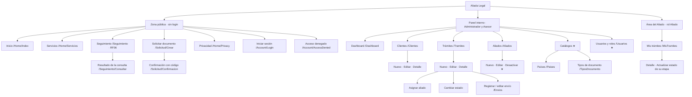

# Mapa del sistema y justificación UX

**Proyecto:** Aliada Legal
**Responsable:** Blanca Rivas (Integrante 1 — UX y documentación)

---

## 1. Mapa del sitio



★ = solo rol Administrador. El Asesor ve la lista de Aliados en modo de solo lectura.

## 2. Inventario de pantallas

| # | Pantalla | Ruta (Controller/Action) | Acceso |
|---|---|---|---|
| 1 | Inicio | `Home/Index` | Público |
| 2 | Servicios | `Home/Servicios` | Público |
| 3 | **Consulta de seguimiento** | `Seguimiento/Index` (GET) | Público · RF06 |
| 4 | **Resultado del seguimiento** | `Seguimiento/Consultar` (GET `?codigo=`) | Público · RF06 |
| 5 | Solicitar documento | `Solicitud/Crear` | Público |
| 6 | Confirmación de solicitud | `Solicitud/Confirmacion` | Público |
| 7 | Iniciar sesión | `Account/Login` | Público |
| 8 | Acceso denegado | `Account/AccessDenied` | Público |
| 9 | Dashboard | `Dashboard/Index` | Administrador, Asesor |
| 10 | Clientes: lista / crear / editar / detalle | `Clientes/*` | Administrador, Asesor |
| 11 | Trámites: lista / crear / editar / detalle | `Tramites/*` | Administrador, Asesor |
| 12 | Registrar / editar envío | `Envios/Create?tramiteId=`, `Envios/Edit` | Administrador, Asesor |
| 13 | Aliados | `Aliados/*` | Administrador (Asesor solo lectura) |
| 14 | **Mis trámites** (lista y detalle) | `MisTramites/Index`, `MisTramites/Details`, `MisTramites/CambiarEstado` | Aliado · RF05 |
| 15 | Países | `Paises/*` | Administrador |
| 16 | Tipos de documento | `TiposDocumento/*` | Administrador |
| 17 | Usuarios y roles | `Usuarios/*` | Administrador |

## 3. Estructura de menús por rol

**Público (sin sesión):**
```
[Logo Aliada Legal]  Inicio | Servicios | Seguimiento | Solicitar documento | [Iniciar sesión]
```

**Administrador / Asesor:**
```
[Logo]  Dashboard | Clientes | Trámites | Aliados | Catálogos ▾ ★ | Usuarios ★ | [Usuario ▾ → Cerrar sesión]
```

**Aliado:**
```
[Logo]  Mis trámites | [Usuario ▾ → Cerrar sesión]
```

- Las opciones se muestran según `User.IsInRole("Administrador")`, `User.IsInRole("Asesor")` o `User.IsInRole("Aliado")`.
- En celular, el menú se colapsa en un botón hamburguesa (Bootstrap `navbar-expand-lg`).

---

## 4. Justificación UX

### 4.1 Tres zonas según el usuario
Hay una zona pública, un panel interno y un área para aliados. Cada usuario ve solo lo que necesita: el cliente, información y la consulta de su trámite; el personal interno, un panel de productividad; el aliado, únicamente sus encargos. Esto aplica el principio de **minimalismo** de Nielsen y refuerza la seguridad por roles (RF05).

### 4.2 Consulta pública sin cuenta (RF06)
El cliente migrante suele usar el celular y no quiere crear otra cuenta. Por eso la consulta funciona con un solo dato, el **código de seguimiento**, y está a un clic desde cualquier página pública. Reduce las preguntas por WhatsApp y le da confianza al cliente, que era su principal frustración.

### 4.3 Privacidad en la consulta pública
La página de seguimiento muestra solo los campos de `TramiteSeguimientoDto` (código, documento, país, estado y fecha). No muestra nombre, correo, teléfono ni observaciones, para que nadie que conozca un código pueda ver datos personales.

### 4.4 El trámite como centro de la navegación
Todo el negocio gira alrededor del trámite. Su pantalla de detalle concentra las acciones relacionadas (asignar aliado, cambiar estado, registrar envío) y el usuario no tiene que navegar entre módulos. Esto reduce clics y carga cognitiva.

### 4.5 Estados visibles con color
Cada `EstadoTramite` tiene una etiqueta (*badge*) con un color fijo: gris = Solicitado, azul = En gestión, cian = Documento obtenido, morado = Apostillado, naranja = En tránsito, verde = Entregado. En la consulta pública se agrega una línea de tiempo con las 6 etapas. Cumple la heurística de **visibilidad del estado del sistema**. El color siempre va acompañado del texto, así que también funciona para personas con daltonismo.

### 4.6 Prevención de errores
- Listas desplegables en lugar de texto libre para cliente, país, tipo de documento y aliado.
- Validaciones en servidor (DataAnnotations en los ViewModels) y en cliente (jQuery Validation) con mensajes en español.
- No se puede pasar a En tránsito sin un envío registrado, y un trámite no puede tener dos envíos.
- El aliado solo ve los estados de su etapa; el servidor también lo valida.
- Los aliados se desactivan en lugar de borrarse, para no perder el historial.

### 4.7 Consistencia
Todas las páginas CRUD siguen el mismo patrón (lista → nuevo/editar → detalle) y usan el mismo `_Layout.cshtml` con Bootstrap 5. Los nombres de roles son los mismos en la documentación, en Identity y en los controladores (Administrador, Asesor, Aliado), lo que evita confusiones (heurística de **consistencia y estándares**).

### 4.8 Diseño responsive
Bootstrap con grid y tablas responsivas. La consulta de seguimiento y el formulario público se diseñan primero para celular (*mobile first*), porque el cliente migrante entra principalmente desde su teléfono.

### 4.9 Lenguaje del usuario
Se usan los términos del negocio (*trámite, apostilla, aliado, código de seguimiento, número de rastreo*) en vez de términos técnicos, y mensajes claros ("Trámite AL-2026-000024 actualizado a En tránsito").

### 4.10 Accesibilidad
- Etiquetas `<label for>` en todos los campos y textos `alt` en las imágenes.
- Contraste mínimo AA (4.5:1) en textos y botones.
- Navegación completa con teclado gracias a los componentes nativos de Bootstrap.
- El resultado de la consulta se anuncia con `aria-live="polite"` para lectores de pantalla.
